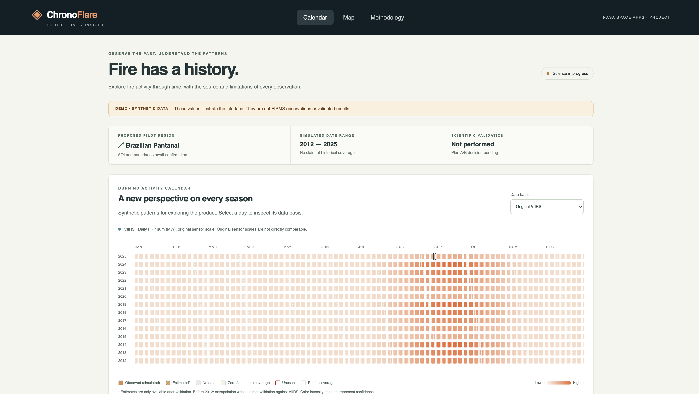
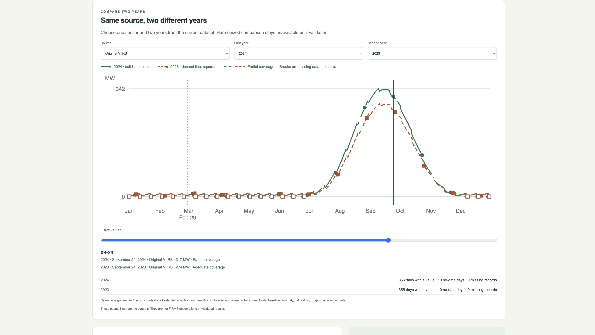
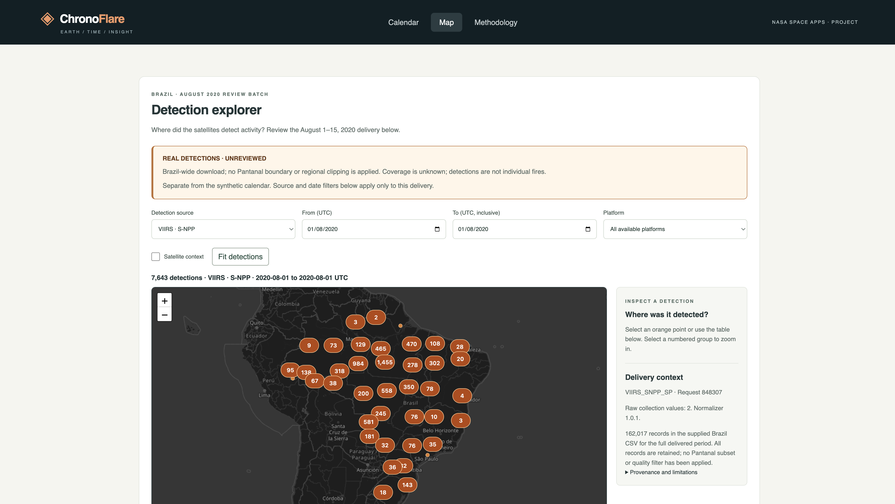
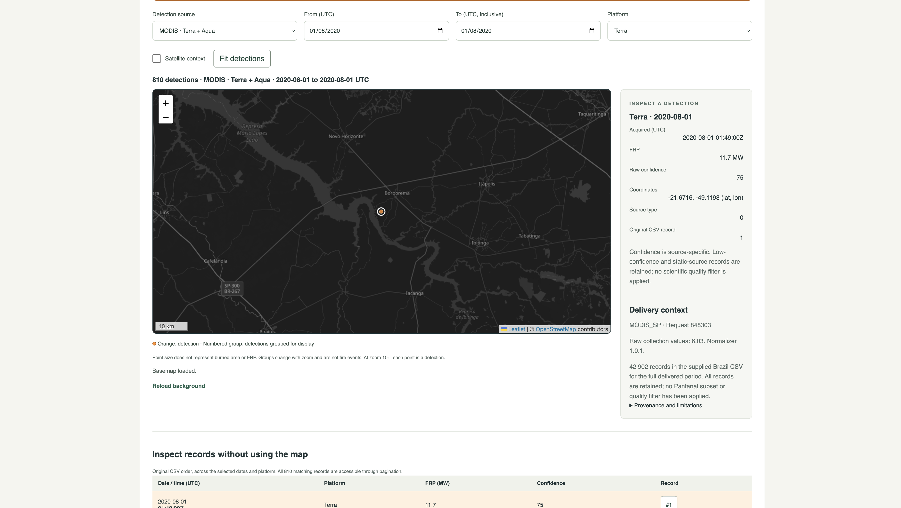
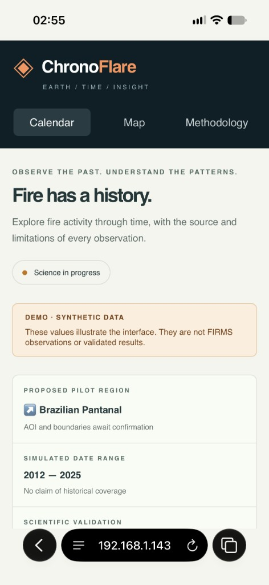
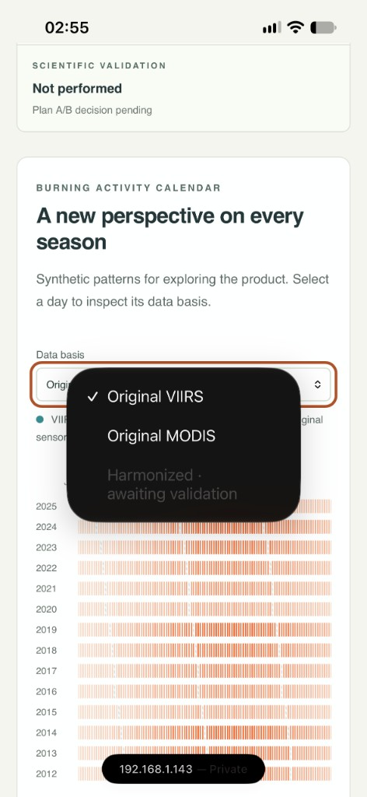
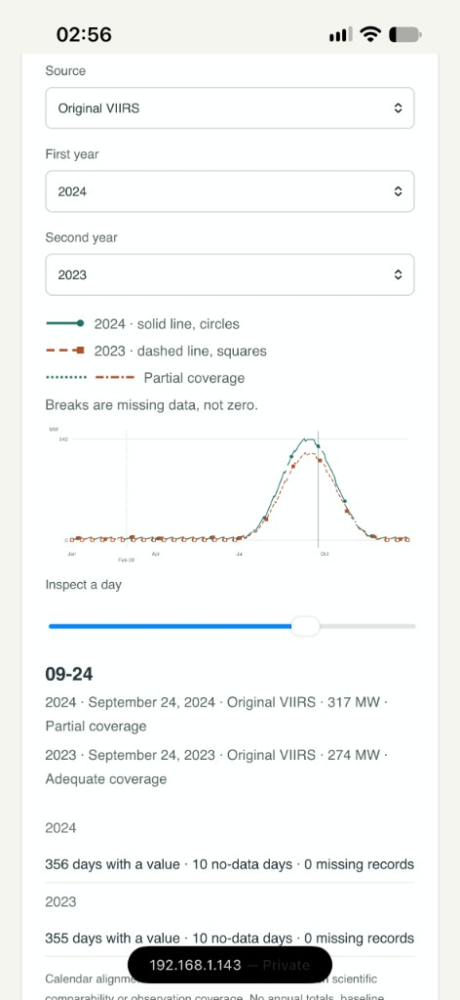
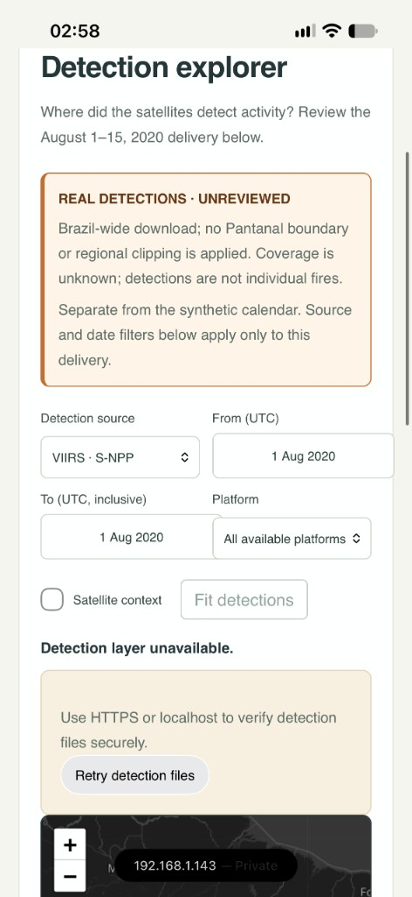

# Calendar, comparison chart, and Map review

15 November 2026. Local review of main `63683d8` (pull requests #20, #21, and #22). This is not the Vercel site. The fork deploy is still `3df191e`, which does not include the chart or the detection map.

One frontend defect was found on the phone and fixed in https://github.com/j-c-fstk-dev/chronoflare/pull/25. Safari threw while drawing February 29 in a non-leap year and the whole page went blank. The calendar now leaves that day empty. The phone screenshots below were taken after that fix.

Scientific rules and the generated datasets were not changed.

## What was checked

Start:

`?view=calendar&basis=viirs&date=2025-09-01&region=pantanal-pilot&compare_basis=viirs&years=2024,2023`

1. Calendar shows the synthetic-data notice, and Harmonized stays unavailable.
2. The comparison chart shows both years, partial coverage, and the 24 September readout.
3. Map shows the unreviewed Brazil detections, separate from the calendar.
4. A detection can be inspected, and Back/Forward keeps the map filters.
5. Returning to Calendar restores the synthetic notice and the 2024/2023 chart.

## Desktop

Cursor browser on macOS, 1920×1080, `http://127.0.0.1:5179`. Passed.

| Step | Result |
| --- | --- |
| Calendar notice | DEMO · SYNTHETIC DATA. Simulated range 2012–2025. Scientific validation not performed. |
| Chart | VIIRS, 2024 and 2023. 24 September: 317 MW, partial coverage, and 274 MW, adequate coverage. |
| Map | REAL DETECTIONS · UNREVIEWED. 7,643 VIIRS S-NPP detections for 1 August 2020. No Pantanal clip. |
| Terra record | MODIS Terra, 810 detections. First record: 2020-08-01 01:49:00Z, 11.7 MW, confidence 75, coordinates −21.6716, −49.1198, CSV record 1. |
| Return | Back restored all MODIS platforms at 2,656. Forward restored Terra at 810. Back to calendar restored the synthetic notice. The URL still kept both the calendar years and the Terra filter. |

## Phone

iPhone Safari, 02:55–02:58, `http://192.168.1.143:5180`. The calendar and chart passed. The map could not load.

| Step | Result |
| --- | --- |
| Calendar notice | DEMO · SYNTHETIC DATA is visible. The page stayed open after the leap-day fix. |
| Harmonized | The option is visible and disabled: “Harmonized · awaiting validation.” |
| Chart | Same 24 September readout as desktop: 317 MW partial, 274 MW adequate. Partial-coverage legend is visible. |
| Map | Detection layer unavailable. The page says: “Use HTTPS or localhost to verify detection files securely.” |
| Terra and Back | Not available. The detections never loaded, so there was no Terra state to restore. Back to calendar shows the normal synthetic page, which is the expected page when the map has no loaded filter to return from. |

The phone address is a plain HTTP network address. The map verifies each detection file in the browser, and that check only runs on HTTPS or localhost. `127.0.0.1` on the computer qualifies. `192.168.1.143` on the phone does not.

## Conclusion

On localhost, Calendar, the comparison chart, and the Map stay distinct, and the filters survive Back, Forward, and the return to Calendar. On the phone, the synthetic calendar and chart match the desktop. The detection map needs a localhost or HTTPS page before the Terra inspection can be repeated there.
